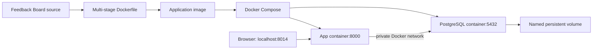

# Module 4: Docker & Containerization

Containerize the working Feedback Board from Module 3. The same HTML/FastAPI app runs in Docker, with a separate PostgreSQL container for the local exercise. Its existing managed-cloud deployment stays available at https://module3-feedback-board.onrender.com.

## Required flow

| Step | Project artifact / action |
| --- | --- |
| Source code | `feedback_board/` contains the page and API |
| Dockerfile | `Dockerfile` installs locked runtime dependencies and copies the application |
| Image | Build `module4-feedback-board:1.0` |
| Container | Run the app as UID/GID 10001 with a health check |
| Docker Compose | `compose.yaml` starts the app and PostgreSQL together |
| Running application | Open http://localhost:8014 and submit feedback |

## Run

Install Docker Desktop with Linux containers, or Docker Engine with the Compose plugin. From the repository root:

```powershell
python scripts/setup_docker.py
docker compose --env-file .env.docker config --quiet
docker compose --env-file .env.docker up -d --build --wait
docker compose --env-file .env.docker ps
```

`setup_docker.py` creates an ignored `.env.docker` with a random local password. It never overwrites an existing file. `.env.docker.example` documents the settings. If port 8014 is occupied, change `APP_PORT` in the ignored file before starting.

Open **http://localhost:8014**. The Docker API should report `{"status":"ok","database":"postgresql"}` at `/health`. These local containers use their own database volume; they do not receive your Supabase/Render credentials or use cloud feedback data.

## Build an image and run a container separately

```powershell
docker build --target runtime -t module4-feedback-board:1.0 .
docker volume create module4-preview-data
docker run -d --name module4-feedback-preview -p 127.0.0.1:8015:8000 --mount source=module4-preview-data,target=/data module4-feedback-board:1.0
```

This standalone container uses local SQLite to illustrate `image → container` without a second service. Open http://localhost:8015. Compose uses PostgreSQL instead. Stop this optional preview with `docker stop module4-feedback-preview`.

## Test and inspect

```powershell
docker build --target test -t module4-feedback-tests:1.0 .
docker run --rm module4-feedback-tests:1.0
docker image inspect module4-feedback-board:1.0 --format '{{.Config.User}}'
docker compose --env-file .env.docker logs --tail 20 app
docker compose --env-file .env.docker exec db pg_isready -U feedback -d feedback
```

The test image contains pytest/HTTPX; the runtime image contains only the app and runtime dependencies. The app runs with a read-only root filesystem, dropped capabilities, bounded logs, and memory/process limits. Secrets are injected only at runtime and excluded from the build context.

Check persistence: submit a message, run `docker compose --env-file .env.docker restart`, then reload. To replace the containers while keeping data:

```powershell
docker compose --env-file .env.docker down
docker compose --env-file .env.docker up -d --wait
```

Compose retains the named PostgreSQL volume. Avoid `down --volumes` if you need its feedback data. The init script runs only when the database volume is empty; subsequent schema changes need a migration.

## Architecture



The database port is not published to the host. The app's port is bound only to loopback. The database uses plaintext connections inside the isolated local Docker network; the application's `cloud` mode still enforces TLS for Supabase.

Containers share the Linux kernel provided by Docker's host; they are processes isolated with namespaces and resource controls. A VM has a separate guest OS/kernel. Docker Desktop on Windows runs these Linux containers using its WSL2 backend.

Layer caching installs dependencies before copying app code, avoiding repeated package installation for source-only edits. Both base images are pinned by version and digest; the runtime installs available OS security updates and removes pip/setuptools after installation. The runtime excludes tests, Git history, local environment files, database files, screenshots, and development tools.

## Submission

- GitHub repository: https://github.com/Gauravwakle96/module-4- (Module 4 files are at the root).
- Dockerfile: `Dockerfile`; Compose: `compose.yaml`; local schema: `docker/init.sql`.
- LinkedIn caption and one screenshot: `module-4-submission/`.
- Module 4 is the local Docker exercise. The Render live URL documents Module 3's native Python deployment; it is not evidence of a cloud container deployment.

CI/CD and active monitoring belong to the later modules. The Docker image and Compose configuration provide their starting point.

## References

[Docker multi-stage builds](https://docs.docker.com/build/building/multi-stage/), [Compose startup order](https://docs.docker.com/compose/how-tos/startup-order/), [Docker volumes](https://docs.docker.com/engine/storage/volumes/), [official PostgreSQL image](https://hub.docker.com/_/postgres).
